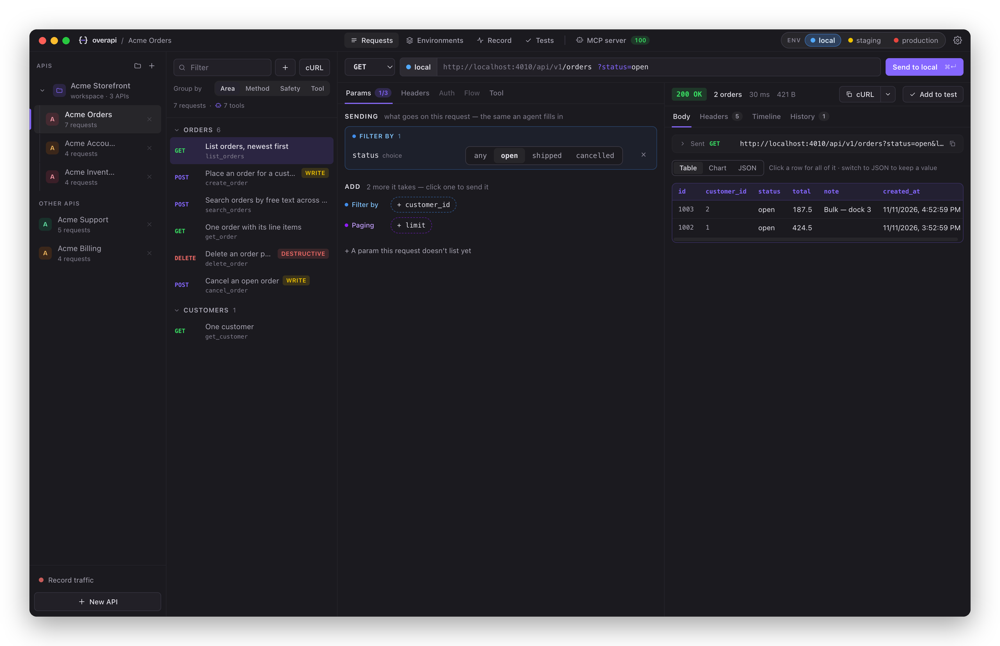
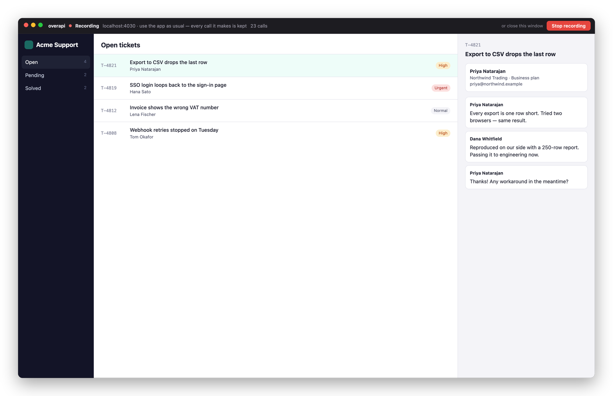
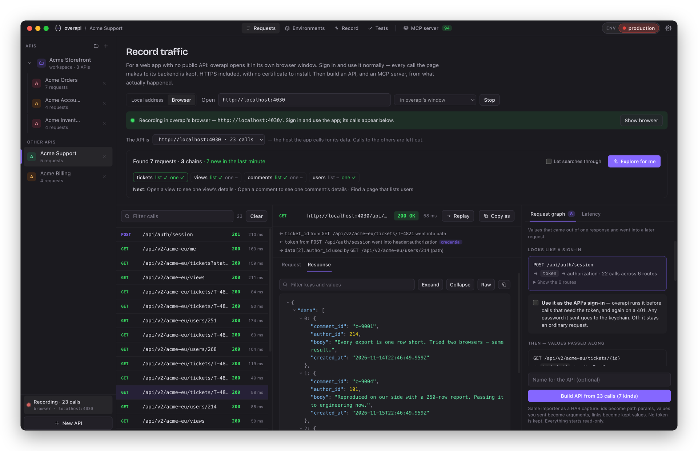
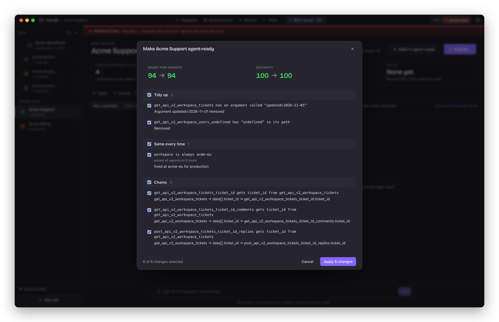
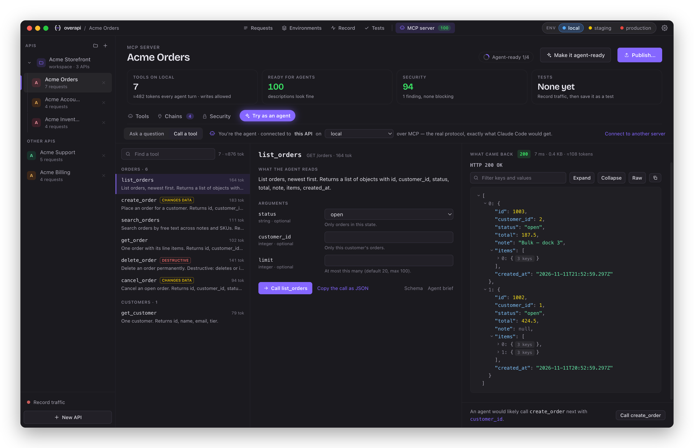
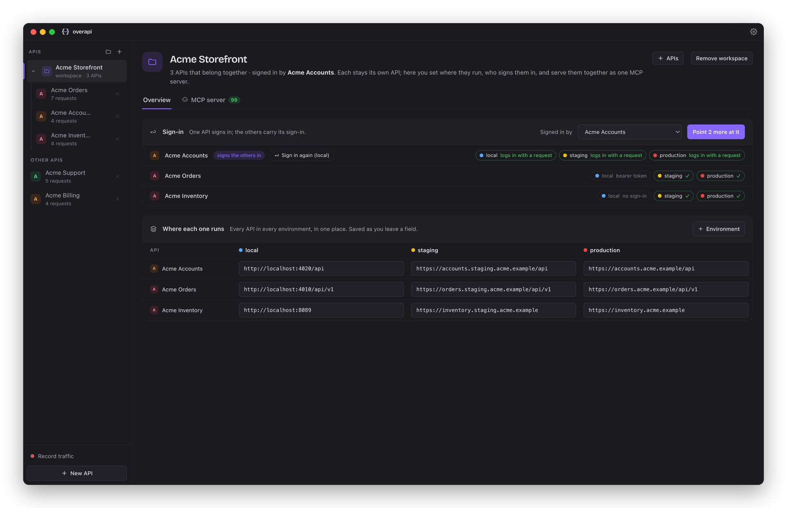
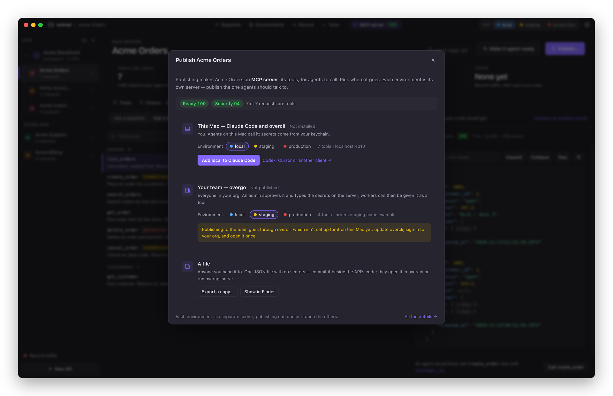
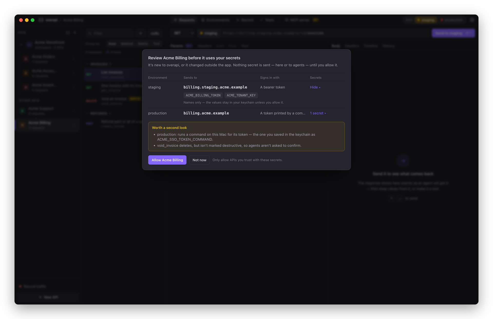

<p align="center">
  
</p>

<h1 align="center">overapi</h1>

<p align="center">
  <b>The API you can't rewrite, as tools your agents can safely use.</b><br>
  An API client on your machine that turns REST, SOAP and recorded web apps into curated MCP servers.
</p>

<p align="center">
  <a href="https://github.com/overcodelions/overapi/actions/workflows/ci.yml"></a>
  <a href="LICENSE"></a>
  
  
</p>

<p align="center">
  <a href="docs/getting-started.md"><b>Getting started</b></a> ·
  <a href="docs/record-a-web-app.md">Record a web app</a> ·
  <a href="docs/sign-in.md">Sign-in</a> ·
  <a href="docs/sharing-and-safety.md">Sharing and safety</a> ·
  <a href="docs/cli.md">CLI</a>
</p>

<p align="center">
  Sibling of <a href="https://github.com/overcodelions/overcli">overcli</a> ·
  <a href="https://github.com/overcodelions/overgit">overgit</a> ·
  <a href="https://github.com/overcodelions/overdb">overdb</a>
</p>

<p align="center">
  
</p>

---

Every company has APIs agents should be able to use — and almost none of them come with a clean spec. Some have Swagger behind a login, some are SOAP, some exist only as the calls a web app makes. Pointing an agent at them raw gets you a hundred cryptic tools, ids it can't find, and a `DELETE` it shouldn't see.

overapi is the step in between. Bring an API in however you can, use it like Insomnia or Postman, then make it **agent-ready** — names that say what they do, descriptions an agent can choose by, ids that flow from one call to the next, writes hidden until you allow them — and publish it as an MCP server. No account, no cloud: it runs on your Mac, and your secrets stay in the keychain.

## Any website, as tools for your agents

The API you need often has no docs and no spec — it's just what a web app calls behind the page. So open the app in overapi, sign in, and use it the way you always do:

<p align="center">
  
</p>

Every call the page makes to its backend is kept — HTTPS included, no certificate to install, no proxy to set up. Pages, scripts, images and analytics are left out. overapi sees which call signed you in, which ids flowed from a list into the next request, and what you haven't opened yet; **Explore for me** can click around for the rest on its own, skipping anything that looks like delete, pay or sign out.

<p align="center">
  
</p>

Then **Build API**: ids become arguments, the sign-in becomes something overapi can redo on its own, and everything starts read-only. *Make it agent-ready* names and describes the tools, and *Add to Claude Code* puts them in your agent — a web app you only had a login for is now an MCP server. Try it with the sample app: `npm run example:webapp`, then Record › Browser › `http://localhost:4030` (any email, password `demo`). The full walk-through: [Record a web app](docs/record-a-web-app.md).

## How it goes

| | |
|---|---|
| **1 · Bring it in** | A spec, a cURL, a HAR, a Postman collection, a WSDL, the docs, the service's own source code — or record the web app that uses it. |
| **2 · Use it** | A fast workbench: environments, sign-in, the params that matter, responses you can read as a table, a chart or JSON, and tests. |
| **3 · Make it agent-ready** | One pass that tidies, connects and documents it — rules first, then your own claude or codex — with every change shown before it's applied. Then try it as an agent. |
| **4 · Publish** | Into Claude Code in one click, to any MCP client as a snippet, to your team through overgo, or as a file to commit. |

## Ways in

- **A server on this Mac.** New API lists what's listening locally — `:4010 node · orders-api — spec · 24` — and imports a served spec in one click. When the spec is behind a login, paste a token and it fetches it anyway; when there is no spec at all, **Read its code** has claude read the service's routes, request and response classes and sign-in (read-only) and draft every endpoint.
- **Import.** OpenAPI 3, Swagger 2, a HAR capture, a Postman v2 collection (folders, OAuth 2, form-data files and GraphQL bodies included), or a WSDL.
- **GraphQL.** Point it at the endpoint (or an introspection file): every query becomes a read tool and every mutation a write, each with its query written out and its arguments typed — so an agent never has to write GraphQL itself.
- **From a cURL.** "Copy as cURL" from the browser: ids in the path become arguments, the values become the example, any token goes to the keychain.
- **From documentation.** PDFs, Markdown or HTML, a docs URL, or pasted text. claude finds the real spec files if the site links to them, and drafts one if it doesn't.
- **Record a web app.** Sign in and use the app in overapi's browser — or your own Chrome, password manager and all — and its API calls become requests ([how it looks](#any-website-as-tools-for-your-agents)). Or let **Explore for me** click around on its own, skipping anything that looks like delete, pay or sign out. No web app at hand? Point **Local address** at an API and use it through overapi's forwarding address instead.
- **SOAP.** Each operation becomes a request with typed arguments; overapi builds the envelope (1.1 or 1.2, WS-Security if needed) and agents see JSON in and out.
- **Paste it anywhere.** ⌘V a cURL, a spec or a docs URL outside a text field and New API opens with it already in.

## The workbench

- **Params as a query, not a form.** What's being sent sits on top, one line each; everything else the request takes waits below as chips. Each kind of value gets its own control: a three-way *any · true · false* switch, chips for lists, a stepper for numbers, fields for objects. The address bar spells out the query as you go, and pasting a URL fills the params from it.
- **Responses you can read.** A list comes back as a table, numbers as a chart when they chart, and the full JSON is always a click away — with headers, a timeline and the request's history beside it.
- **Values it has already seen.** Click an id and pick from the ones earlier responses held, by name — "Acme Supply Co", not `076f0e8a…`. Nothing seen yet? Run the request that lists them, from the same dropdown.
- **Chains.** overapi works out which request gives the ids another needs (`list_accounts → content[0].id → get_account.accountId`), keeps them for the next call, and runs a login first when the API needs one.
- **Environments.** Local, staging and production, colour-coded, each with its base URL, sign-in, variables and headers. New environments start read-only; allowing writes on production means typing its name.
- **Sign-in, however it works.** A token, an API key, user and password, WS-Security, **OAuth 2** — client credentials, or a person signing in once in the browser (PKCE) with tokens refreshed from then on, for agents too, with one-click setup for Google, Microsoft, Okta and Auth0 — a **token from a command** (`gcloud auth print-access-token`, `az account get-access-token`, your SSO tool's), a login request (refreshed when refused), the session from a browser sign-in, or **another API's**. When a sign-in runs out, *Sign in again* redoes it the right way and resends.
- **Client certificates.** Mutual TLS per environment: a cert and key, or a .p12 bundle, and a private CA if you need one.
- **Bodies.** JSON, form, multipart with file uploads, GraphQL with variables, and SOAP. Agents send a file's content, never a path on your Mac.
- **Copy as code.** cURL, fetch, Python or HTTPie, secrets shown as •••.
- **Tests.** Turn a recording — or a response, with *Add to test* — into a test that checks status and response shape, and run it in CI (`overapi test --junit`). Load-testing a scenario's reads is there too, off by default (Settings › General) — pointed at the wrong environment it's the easiest way to hurt a real API.
- **⌘K** jumps to any request, API or workspace.

## Agent-ready

Each API has an **MCP server** page — what agents get from it, with how ready it is in the title bar.

- **Make it agent-ready.** Tidies what a recording picked up, fixes values that never change, connects the chains, then your claude or codex writes descriptions, argument help, clearer names, what to hide, a brief for the agent and example questions. You see every change, before → after, and the readiness and security scores move as you pick. No claude or codex? *Steps 1–3 only* runs the rules on their own.

<p align="center">
  
</p>

- **Tools.** A budget bar, suggestions for what to turn off and why, and a per-tool editor.
- **Chains.** Which tool gives the ids another needs, and what the agent is told about it.
- **Security scan.** Leaked secrets, what agents can reach, prompt injection in descriptions, personal data in examples. Critical findings block team publishing until fixed or accepted with a reason.
- **Try as an agent.** Ask a question in plain words; claude answers through this API's own MCP server, read-only, and you watch every tool call. Save the run as a test. Or *Call a tool* yourself — no AI — and see exactly what the agent reads back, and what it would likely call next.

<p align="center">
  
</p>

## Workspaces

Services that belong together — the APIs of one product — grouped, with **one sign-in** (the security service signs the others in), **one place to set where each runs** in every environment, and **one MCP server** for the lot, with ids flowing from one service to the next. A workspace is a file too (`overapi-system.json`), and `overapi serve` runs it.

<p align="center">
  
</p>

## Publish

- **This Mac.** *Add to Claude Code* installs it (per environment); snippets for Codex and any MCP client carry placeholders, never secrets.
- **Your team.** Hand it to overgo through overcli: only the chosen environment, the tools that are on, and the *names* of its secrets. An admin finishes it in overgo's console.
- **Git.** A project is a folder: `overapi.json` — readable, diffable, and what `overapi serve` runs — beside a `.gitignore` that keeps `.env` out. Commit it with the API's code; teammates open the folder and add their own secrets. That's the shared collection: no account, no cloud workspace.

<p align="center">
  
</p>

## Safety

- Tools are read, write or destructive. Write tools stay hidden until an environment allows writes; destructive ones also need `confirm: true` and carry `destructiveHint`, so clients ask you first.
- Secrets live in the keychain, never in a project file, and are scrubbed from everything shown or returned. The renderer can set a secret but never read one.
- Your browser sign-ins are yours: they never publish.
- A project from someone else — a clone, a pull that changed where it sends things or how it signs in — can't use your secrets until you've reviewed where they'd go and allowed it: in the app, and for agents through the app's `serve`. Your own edits keep a project approved, and one with nothing secret isn't asked about. (Run straight from the CLI, overapi trusts the file you hand it — running it is the choice.)
- Token commands only come from your keychain, only files you pick are uploaded, and agents' own arguments can't name secrets. OAuth sign-in pages open only over https, and the recorder answers only localhost.
- AI runs use your own CLI and login, with file-reading tools only.

<p align="center">
  
</p>

More in [Sharing and safety](docs/sharing-and-safety.md) and [SECURITY.md](SECURITY.md).

## CLI

The app is also a command line — the same code an MCP client runs.

```sh
overapi import  examples/acme-orders.openapi.yaml -o ~/overapi/acme-orders
overapi tools   ~/overapi/acme-orders/overapi.json        # what each environment offers
overapi check   ~/overapi/acme-orders/overapi.json        # what will trip an agent up
overapi call    ~/overapi/acme-orders/overapi.json list_orders --env local --args '{"status":"open"}'
overapi serve   ~/overapi/acme-orders/overapi.json --env local   # what clients run
overapi install ~/overapi/acme-orders/overapi.json --env local --client codex   # its client config
overapi test    ~/overapi/acme-orders/overapi.json --junit results.xml
overapi load    ~/overapi/acme-orders/overapi.json --scenario checkout --users 20 --duration 30
overapi scan    ~/overapi/acme-orders/overapi.json --fail-on high
```

`overapi serve` also takes a workspace file and serves all its APIs as one server. From a checkout, use `node dist/cli/index.js` in place of `overapi`. Every command and flag: [docs/cli.md](docs/cli.md).

## Run it

Download the signed, notarized Mac app from [GitHub Releases](https://github.com/overcodelions/overapi/releases/latest) — Apple Silicon or Intel. It keeps itself up to date; Settings chooses automatic or ask-first, stable or beta (nightly builds go to beta).

To run it from source you need Node.js 22.12 or newer and macOS.

```sh
npm install
npm run dev              # Vite + Electron
npm run example:server   # a sample REST API: Acme Orders on :4010, token dev-token
npm run example:soap     # a sample SOAP service: Acme Inventory on :8089
npm run example:webapp   # a sample web app to record: Acme Support on :4030, password demo
npm test
npm run dist:mac         # build the .dmg and .zip
```

The README screenshots are generated from fictional data; see [docs/screenshots](docs/screenshots/README.md) to regenerate them.

| Folder | |
|---|---|
| `src/core` | Importers, HTTP and SOAP calls, sign-in, the MCP server, tests and load — never imports Electron |
| `src/shared` | The project model, chains, checks, the security scan, workspaces |
| `src/main` | Electron main: keychain, recording browser, Chrome recording, explorer, AI runs |
| `src/renderer` | The app — React, Zustand, Tailwind |
| `src/cli` | The command line, under plain Node |

## Status

Pre-1.0, building in the open with Owen Farr. See the [CHANGELOG](CHANGELOG.md) for what's in it.

## License

[Apache-2.0](LICENSE). The overapi name and logo are covered by [TRADEMARKS.md](TRADEMARKS.md).
