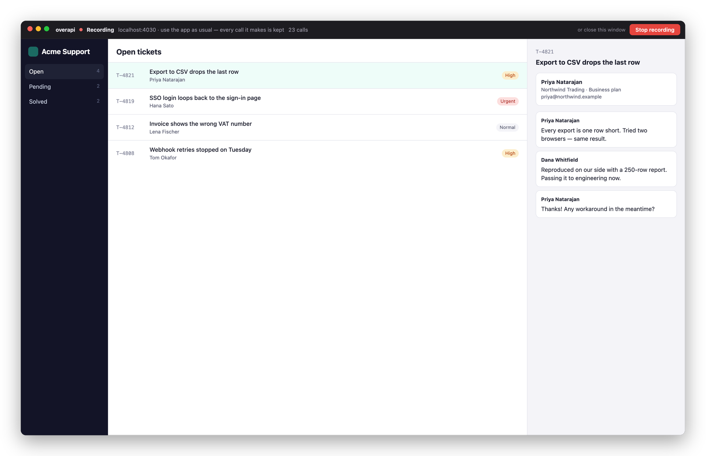
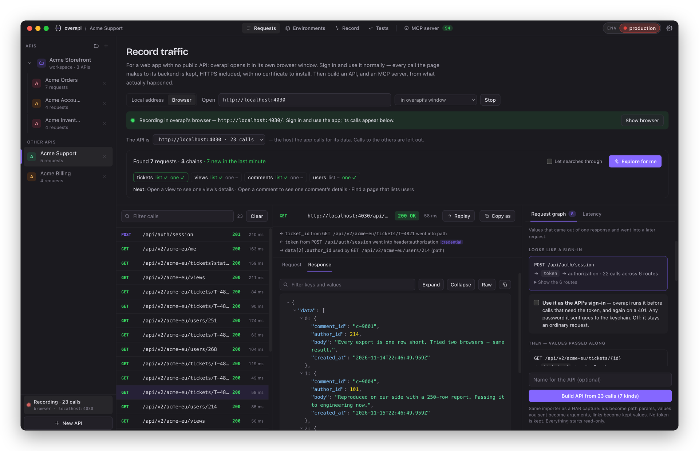

# Record a web app

Plenty of systems have an API with no docs and no spec: it exists only as the calls their own web app makes. If you can sign in to the website, overapi can turn what it calls into tools for your agents.



## Try it on the sample

From a checkout of this repo:

```sh
npm run example:webapp   # Acme Support on http://localhost:4030
```

Sign in with any email and the password `demo`. Then follow the steps below with `http://localhost:4030` as the address.

## 1. Open it and record

1. Press **Record traffic** at the bottom of the sidebar.
2. Choose **Browser**, type the web app's address, and press **Open and record**.
3. A window opens on the site with overapi's bar across the top. Sign in and use the app the way you normally would: open lists, open one item, switch views.

What's kept is only the page's own data calls (fetch and XHR) — not pages, scripts, images or analytics. HTTPS works with no certificate to install and no proxy: overapi owns this browser, so it reads the traffic directly. Nothing else on your Mac is touched.

**Your own Chrome instead.** If you sign in with a password manager or need an extension, pick *in Chrome (with extensions)* next to the address. It runs on a Chrome profile of overapi's own, separate from your usual one.

**Signing in is remembered** per site, so recording the same app again doesn't mean signing in again.

## 2. Watch what it finds

Back in overapi, the calls arrive as you click:



- **The API is** — the host the app calls for its data. Calls to anything else (a CDN, analytics) are left out. Change it if overapi guessed wrong.
- **Coverage** — the kinds of things found (tickets, comments, users), whether you've seen a list of each and one item's details, and what to open next.
- **Request graph** — which response fed which later request. A token from a sign-in call that goes into later `Authorization` headers shows up under *Looks like a sign-in*; an id from a list that goes into the next request's path shows up under *values passed along*.
- Click any call to see exactly what went out and came back, **Replay** it, or **Copy as** cURL, fetch, Python or HTTPie. Copies include the real cookies and tokens — keep them to yourself.

### Explore for me

Rather than clicking everything yourself, press **Explore for me** and overapi clicks around the app on its own to find what you haven't. While it explores, only reads leave the window: anything that would change something — delete, pay, sign out, a form that posts — is stopped before it's sent. Searches are skipped too unless you tick **Let searches through**. Exploring works in overapi's own window, not in Chrome.

## 3. Build the API

When coverage looks right, give it a name and press **Build API from N calls**. It's the same importer as a HAR capture:

- ids in paths become path parameters, and values you sent become arguments
- ids that flowed from one response into the next request become chains
- no token is kept, and every tool starts read-only

If the graph found a sign-in, tick **Use it as the API's sign-in** before building: overapi will run that request itself before calls that need the token, and again whenever the API answers 401. Any password it sent goes to the keychain.

Not ready to set up a sign-in? The browser session works too: the environment can **use the browser sign-in**, sending the cookies from the session you just recorded. They're yours and expire with the session, and they're never published to anyone else.

## 4. Make it agent-ready and add it

A raw recording has names like `get_api_v2_workspace_tickets_ticket_id`. Open **MCP server › Make it agent-ready** and it becomes `get_ticket`, with a description an agent can choose by, the workspace fixed at the value you always use, and `ticket_id` chained from the ticket list. Then **Publish › Add to Claude Code**.

See [Getting started](getting-started.md#4-make-it-agent-ready) for those two steps.

## No web app? Use a local address

**Record traffic › Local address** works for anything that talks to an API: a script, a CLI, a mobile app in a simulator, a test suite. overapi listens on `http://localhost:4545` and forwards every call untouched to the real API, keeping a copy. Point the client at the local address, use it, and build from what was recorded. It lists the servers running on this Mac, so a local API is one click.

## Be careful with what you record

- Record where you're allowed to. Using a company's private API may be against its terms even when you can sign in.
- A recording can contain personal data from the responses. The [security scan](sharing-and-safety.md#the-security-scan) flags personal data in examples before you share a project.
- Writes you make while recording really happen. Use a test account or a staging site when you can.
